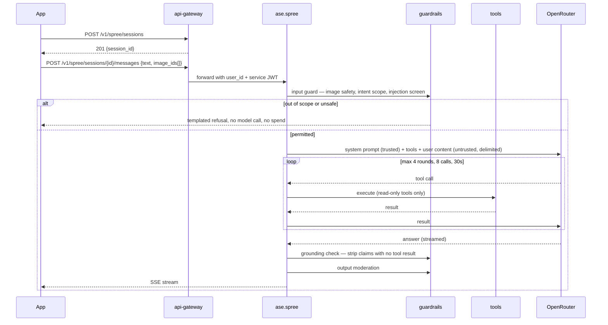
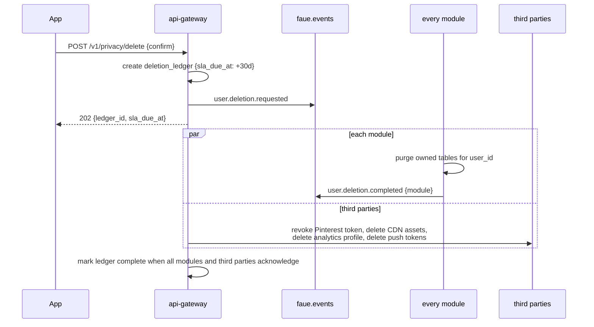

# Data Flows

**Stage:** MVP · **Companion documents:** [`hld.md`](hld.md), [`event-catalog.md`](event-catalog.md), [`../30-contracts/openapi/gateway.v1.yaml`](../30-contracts/openapi/gateway.v1.yaml)

How a request becomes a result. Every endpoint, event, and table named here matches the contracts exactly; if you find a divergence, the contract is right and this document is the bug.

---

## 1. Authentication — magic link

The app never asks for a password. A user enters an email address, receives a link, and taps it.

```mermaid
sequenceDiagram
    participant App as Flutter app
    participant GW as api-gateway
    participant R as Redis
    participant M as Email provider
    participant Web as faue-web

    App->>GW: POST /v1/auth/link/request {email, session_challenge}
    GW->>GW: rate limit (per identifier, per IP)
    GW->>GW: mint 32-byte opaque token
    GW->>R: store SHA-256(token) → {email, challenge, ttl 10m, used=false}
    GW->>M: send link https://faue.app/auth/verify?t=<token>
    GW-->>App: 202 Accepted {expires_in: 600}

    Note over App: App polls or waits on deep link

    App->>Web: user taps link (universal / app link)
    alt App installed
        Web-->>App: deep link opens app with token
        App->>GW: POST /v1/auth/link/consume {token, session_challenge}
    else App not installed
        Web->>Web: confirmation page, explicit button (POST)
        Web->>GW: POST /v1/auth/link/consume {token}
        GW-->>Web: session; page offers store links
    end

    GW->>R: atomically mark used; reject if already used or expired
    GW->>GW: upsert users + auth_identities
    GW-->>App: 200 {access_token 15m, refresh_token 30d, is_new_user}
    GW->>GW: emit user.registered (first time only)
```

### The three failure modes and their mitigations

| Failure | Why it happens | Mitigation |
|---|---|---|
| Token consumed before the user taps | Mail security scanners pre-fetch every URL in a message | Consumption is **POST only**. The `GET` on the link renders a page; it never spends the token. |
| User requests on phone, opens mail on laptop | Normal behaviour, not an edge case | `session_challenge` binds the request to a device. On mismatch the landing page shows a 6-digit code to type into the original app session rather than failing. |
| Link opens a browser instead of the app | Missing or mismatched deep-link configuration | `faue-web` serves `apple-app-site-association` and `assetlinks.json`; when the app is absent, the web page completes the login and offers store links, preserving the token. |

**Token properties:** opaque 32 random bytes, stored only as a SHA-256 hash, 10-minute TTL, single-use, one active token per identifier (requesting again invalidates the previous), rate-limited per identifier and per IP. Never a JWT — a signed token in a URL is a bearer credential that survives in browser history, referrer headers, and mail server logs.

### OAuth providers

```
POST /v1/auth/oauth/google  {id_token}
  → verify signature, iss, aud, nonce, exp server-side against Google's JWKS
  → never trust a client-supplied profile

POST /v1/auth/oauth/apple   {identity_token, authorization_code, full_name?}
  → verify against Apple's JWKS
  → persist full_name immediately: Apple returns it ONLY on first authorization
  → private-relay addresses are normal; email is not a reliable identity key
```

**Account linking** happens only on a **verified** email match. Unverified auto-linking is an account-takeover path and is forbidden. Users link additional providers explicitly from profile settings.

### Session lifecycle

```
access token   15 minutes, JWT, contains user_id + scopes
refresh token  30 days, opaque, stored hashed, rotating
               → each use issues a new token and invalidates the old
               → reuse of an invalidated token revokes the entire family (theft detection)
logout         revokes the presented refresh family
```

---

## 2. Style DNA quiz

```mermaid
sequenceDiagram
    participant App
    participant GW as api-gateway
    participant DB as PostgreSQL
    participant MQ as faue.events
    participant MED as media module
    participant ASE as ase

    App->>GW: GET /v1/quiz — question and option definitions
    GW-->>App: 200 {quiz_version, questions[]}
    Note over App: 6 questions, one per screen, progress 0→90%

    App->>GW: POST /v1/quiz/submit {quiz_version, answers}
    GW->>GW: score (pure function, no I/O)
    GW->>DB: upsert style_preferences; insert quiz_responses (append-only)
    GW->>DB: write outbox row (same transaction)
    GW-->>App: 200 {dna:{dominant, alter_ego, wildcard}, tagline, card_urls:{status:"pending"}}
    GW->>MQ: quiz.completed

    par card render
        MED->>MED: render square 1080×1080 + stories 1080×1920
        MED->>MQ: media.card.ready
    and style context
        ASE->>ASE: build DNA vector, cache user_style_context
    end

    App->>GW: GET /v1/quiz/card (poll)
    GW-->>App: 200 {square_url, stories_url} once ready
```

Scoring is a pure function over the answers and a versioned configuration — no database reads, no model call, fully deterministic. This is what allows the `dna_answers` golden set to gate it at 100% correctness.

Card rendering never blocks submission; the result screen appears immediately and the card fills in.

**Retake** is available from Profile, rate-limited to once per 30 days. `quiz_responses` is append-only so DNA evolution is analysable; `style_preferences` holds current state only.

---

## 3. Look generation

The core loop, and the only flow with a job model.

```mermaid
sequenceDiagram
    participant App
    participant GW as api-gateway
    participant ASE as ase
    participant R as Redis
    participant IMG as Image provider
    participant MQ as faue.events

    App->>GW: POST /v1/looks/generate {source, item_ids?, fabric_id?,<br/>occasion, mood?, note?, use_weather}
    GW->>GW: check consent (personalization, ai_processing), budget, rate limit
    GW->>ASE: POST /internal/looks/generate (service JWT)
    ASE->>R: create job {status: queued, progress: 0}
    ASE-->>GW: 202 {job_id}
    GW-->>App: 202 {job_id, stream_url, poll_url}

    App->>GW: GET /v1/looks/jobs/{job_id}/stream (SSE)

    ASE->>ASE: 1 resolve style context (DNA + aspiration + behaviour)
    ASE->>R: progress 10 — analyzing
    ASE->>ASE: 2 hard filters → legal pool
    ASE->>ASE: 3a compute colour prior over pool
    ASE->>ASE: 3b stylist pass — model selects and assembles
    ASE->>ASE: 3c validate ids against pool; drop unknown
    ASE->>R: progress 40 — assembling
    ASE->>ASE: 4 rank assembled looks
    ASE->>IMG: 5 render (generative default)
    ASE->>R: progress 70 — rendering
    ASE->>ASE: 6 reasoning text, grounded in the chosen look
    ASE->>R: progress 100 — done
    ASE->>MQ: look.completed

    GW-->>App: SSE done event {look_ids}
    App->>GW: GET /v1/looks/{id}
```

### Progress states

`queued` → `analyzing` → `assembling` → `rendering` → `done`, or terminal `failed`. Each carries a percentage and a human-readable label matching the design's copy ("Building your fit…", "Creating your styles…").

### Failure

Any stage failing produces the designed error state — "We couldn't create this look / Try adjusting your inputs or generate again" — and emits `look.failed` with a reason code. Raw errors never reach the user. A rendering failure after successful assembly still returns the look with a placeholder image rather than discarding the work.

### Related actions

```
POST /v1/looks/{id}/save        → saved_looks; emits look.saved
POST /v1/looks/{id}/regenerate  → new job, same inputs, excludes the previous result
POST /v1/looks/{id}/adjust      → new job with modifications (swap item, change occasion)
POST /v1/looks/{id}/share       → share image + public URL; emits look.shared
POST /v1/looks/{id}/feedback    → feedback_signals; emits recommendation.feedback
```

---

## 4. Fabric styling

```mermaid
sequenceDiagram
    participant App
    participant GW as api-gateway
    participant MED as media module
    participant ASE as ase
    participant MQ as faue.events

    App->>GW: POST /v1/uploads/sign {kind: "fabric"}
    GW-->>App: 200 {upload_url, asset_id} (short-lived credential)
    App->>MED: direct upload
    MED->>MED: PII pipeline — classify, EXIF strip, face redact, OCR redact
    MED->>MQ: fabric.uploaded

    App->>GW: POST /v1/fabric/{asset_id}/style {fabric_type?, occasion?, gender?, constraints?}
    GW->>ASE: POST /internal/fabric/suggest
    ASE->>ASE: embed fabric image
    ASE->>ASE: classify type (embedding kNN over labelled swatches; vision fallback)
    ASE->>ASE: rule match over style library (suitability, occasion, formality)
    ASE->>ASE: rank surviving styles
    ASE->>ASE: per-style reasoning, grounded in fabric attributes + style tags
    ASE->>ASE: accessory pairings, occasion-aware
    ASE-->>GW: 200 {detected_type, confidence, styles[3-5]}
    GW-->>App: 200
    ASE->>MQ: fabric.styled

    App->>GW: POST /v1/fabric/{asset_id}/tailor-share {style_id, notes}
    GW->>MED: composite fabric + style reference + notes + branding
    MED-->>GW: share image URL
    GW-->>App: 200 {share_image_url}
    GW->>MQ: tailor.share.created
```

Style **selection** is rules-first here, unlike look generation. Thirty styles across six fabric types is 180 combinations with real physical constraints — heavyweight Aso-Oke will not drape as a Boubou, large-motif Ankara loses its pattern in a heavily seamed cut. A wrong match costs the user real money at a tailor, so the model classifies and narrates but does not choose.

---

## 5. Vault

```
POST   /v1/uploads/sign {kind:"vault_item"}   → signed upload
POST   /v1/vault/items {asset_id, name, category, color, notes?}
                                              → vault_items; emits vault.item.added
GET    /v1/vault/items?category=&cursor=      → paginated, filterable
GET    /v1/vault/items/{id}
PATCH  /v1/vault/items/{id}
DELETE /v1/vault/items/{id}                   → confirmation modal in the app
POST   /v1/vault/items/{id}/style             → look generation seeded by this item
POST   /v1/vault/wear {item_ids[], occasion?, worn_on}
                                              → wear_log; emits vault.item.worn
```

Categories match the design exactly: Tops, Bottoms, Native, Shoes, Accessories.

On `vault.item.added`, `ase` embeds the item image and stores it in `vault_embeddings`, making it immediately available to the legal pool for generation.

The wear log is the strongest behavioural signal in the system. It feeds `behavior_vector` in the user's style context and is what the agent learns from.

---

## 6. Pinterest — connect, import, reconcile

```mermaid
sequenceDiagram
    participant App
    participant GW as api-gateway
    participant PIN as Pinterest
    participant W as sync worker
    participant MED as media module
    participant ASE as ase

    App->>GW: GET /v1/integrations/pinterest/authorize
    GW-->>App: 200 {authorize_url} (OAuth2 + PKCE, state stored)
    App->>PIN: user authorises (read-only: boards:read, pins:read)
    PIN->>GW: GET /v1/integrations/pinterest/callback?code&state
    GW->>PIN: exchange code for tokens
    GW->>GW: encrypt tokens; store integration_accounts
    GW-->>App: redirect back into the app
    GW->>MQ: integration.connected

    App->>GW: GET /v1/integrations/pinterest/boards
    GW-->>App: 200 {boards[]}
    App->>GW: POST /v1/integrations/pinterest/import {board_ids[]}
    Note over App,GW: user selects boards — never all by default

    W->>PIN: paginate pins per board (cursor persisted)
    W->>MED: cache images through the PII pipeline
    W->>ASE: embed pins
    ASE->>ASE: aspiration_embeddings; aspiration_vector per board and per user
    W->>MQ: integration.synced
```

### Reconciliation

Import alone is not the value — Pinterest already does that. Reconciliation resolves aspiration against reality:

| Outcome | Condition | Result |
|---|---|---|
| **Reproduce** | Close match exists in the vault or catalog | Show it, buyable or wearable now |
| **Adapt** | The look conflicts with body profile, occasion mix, or budget | Same aesthetic, adjusted, with the reason stated plainly |
| **Bespoke path** | No ready-to-wear match exists | Route to the fabric flow with a style-library match |

Imported pins stay private to the user and are never republished. Token refresh happens on 401; revocation stops the worker permanently and marks the account disconnected.

**Instagram is out of scope** — the platform API cannot return a user's saved posts or collections, so the promised capability is not deliverable. See [`hld.md`](hld.md).

---

## 7. Spree — conversational styling



Tools available: `ase.find_similar`, `ase.pair_items`, `ase.check_occasion_fit`, `vault.list_owned`, `profile.get_constraints`, `context.weather_today`, and `catalog.search` from M1-2.

Every tool is **read-only**. Nothing mutates state or spends money, so a successful prompt injection still cannot do anything beyond producing text that is then validated. `profile.get_constraints` returns abstract silhouette rules (`avoid: boxy_crop`), never raw measurements.

---

## 8. Agent — daily styling

```
scheduler (per user, at their chosen hour, in WAT)
  → check consent: agent_proactive
  → gather context: weather (geohash5), calendar hints, wear log, saved looks, DNA
  → generate suggestion via the look pipeline, biased to items owned and rarely worn
  → store agent_runs
  → emit agent.suggestion.ready
notify consumes → push, subject to quiet hours and frequency cap
user opens → accept / dismiss / regenerate
  → agent_memory updated (episodic + semantic)
```

Memory is three-tiered and inspectable:

| Tier | Contents | Lifetime |
|---|---|---|
| Profile facts | From quiz and body profile | Durable until changed |
| Semantic preferences | Learned weights: colours, silhouettes, brands, formality | Decayed over time |
| Episodic | What was worn or suggested, and the outcome | 90 days |

"Why did you suggest this?" answers from stored facts, never from a re-prompted guess.

---

## 9. Notifications

```
event on faue.events
  → notify consumer
  → resolve template + locale
  → check consent purpose for the category
  → check quiet hours (WAT) and per-user frequency cap
  → dedupe on event_id
  → dispatch to channel (push | whatsapp | email | sms | inbox)
  → record notify_deliveries
  → delivery / open callbacks recorded back onto the stream
```

No service sends a message directly. Every path routes through the notify module, which is why caps and preferences cannot be bypassed by a new feature that forgets about them.

---

## 10. Data subject requests



Export follows the same fan-out, producing a downloadable archive. Rectification and restriction are handled synchronously against the gateway's own tables.

Offering Sign in with Apple makes in-app account deletion a store requirement, so this flow is launch-blocking, not a later addition.

---

## 11. Cross-flow invariants

1. **Consent is checked before work, not before response.** No consent means the feature is unavailable and says so; it never means an error after the model has already been paid for.
2. **Every model output is validated against the legal pool** before it reaches a user. Unknown identifiers are dropped, never repaired.
3. **Every user image passes the PII pipeline** before storage, sharing, or model input. There is no path that skips it.
4. **Every state change that others care about writes an outbox row in the same transaction.** No exceptions, including admin actions.
5. **Every long operation is a job with visible progress.** If it can exceed two seconds, it is not a request.
6. **Every model-backed path has a template fallback.** Degraded is acceptable; broken is not.
