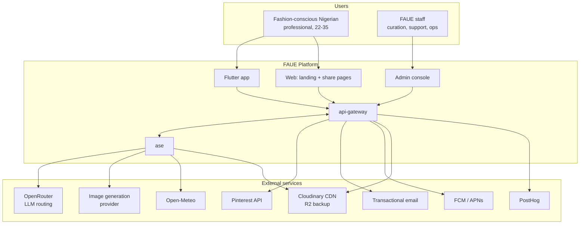
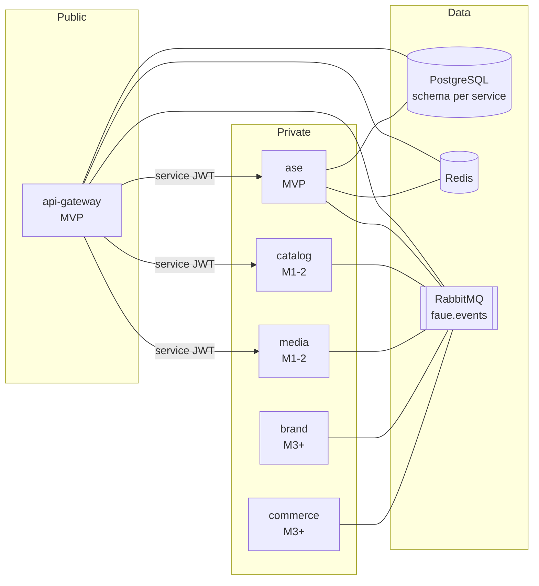
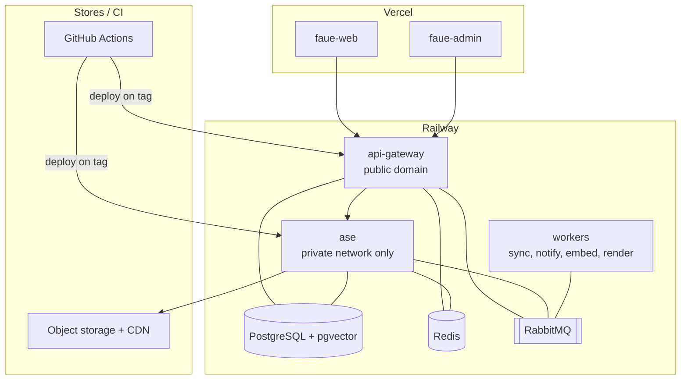

# High-Level Design

**Stage:** all · **Source:** [design specification](../superpowers/specs/2026-08-17-faue-platform-architecture-design.md)

The shape of the system: what the services are, what each owns, how they talk, and what they run on. Detail lives in the per-service low-level designs; this document is the map you read first.

---

## 1. System context

FAUE is a mobile-first styling platform. A user answers a six-question quiz, builds a vault of clothes they own, uploads fabric they have bought, and receives complete looks — generated, explained, saveable, and shareable.



### Trust boundaries

| Boundary | Crossing | Control |
|---|---|---|
| Public internet → gateway | User requests | TLS, JWT, rate limiting, input validation |
| Gateway → ase | Internal calls | Private network, short-TTL service JWT with audience claim; ase has no public ingress |
| Ase → model providers | Prompts, images | PII redaction before egress, zero-retention provider allowlist, no raw user data |
| Pinterest → ingest | Imported pins and captions | Treated as untrusted content; injection screening; images through the PII pipeline |
| User uploads → system | Photographs | Safety classification, EXIF strip, face redaction, OCR redaction |
| Staff → admin | Privileged operations | Separate auth realm, MFA, RBAC, immutable audit log, network gate |

---

## 2. Services

| Service | Stage | Ingress | Schema | Owns |
|---|---|---|---|---|
| `api-gateway` | MVP | Public | `gateway` | Identity, profile, body profile, quiz and scoring, vault, wear log, saves, actions, integrations, notifications, privacy and DSR, admin API |
| `ase` | MVP | Internal | `ase` | Style vectors, embeddings, retrieval, look generation, fabric analysis, style library, spree, agent, weather context |
| `catalog` | M1-2 | Internal | `catalog` | Brands, products, ingestion, enrichment, link health |
| `media` | M1-2 | Internal | `media` | Uploads, image PII pipeline, share-card and tailor-share rendering |
| `brand` | M3+ | Internal | `brand` | Brand dashboard, self-serve catalog, promoted placement, brand analytics |
| `commerce` | M3+ | Internal | `commerce` | Subscriptions, affiliate ledger, payouts, marketplace orders |

Only `api-gateway` is reachable from the internet. Everything else sits on a private network and is called by the gateway or driven by events.



### Why these boundaries

**Gateway and ase split** because they have opposite operational profiles. The gateway is I/O-bound, latency-sensitive, and holds all the PII. Ase is compute-bound, tolerant of seconds-long work, and holds no direct identifiers. They scale differently, fail differently, and deploy at different cadences.

**Catalog separate from ase** because scraping and bulk enrichment are batch workloads that must never share a request path with a user waiting for a look.

**Media separate** because image processing is CPU-spiky and its outputs are cacheable, so it scales on a different curve from either.

**Brand and commerce separate** because they arrive with different consumers (partners, not users) and different compliance requirements (financial records), and because they should never be able to reach user PII directly.

---

## 3. Folded modules

Two bounded contexts run as modules today and become services when load or team size justifies it.

| Module | Host | Future service | Extraction trigger |
|---|---|---|---|
| `spree` | `ase` | `spree` | Conversational load competes with generation for capacity |
| `notify` | `api-gateway` | `notify` | Send volume or channel count needs independent scaling |

### The four seams

Extraction is a deploy change and nothing else, provided these hold from the first commit:

1. **Table ownership.** A module owns its tables, prefixed by module name (`spree_sessions`, `notify_deliveries`). No other module reads them.
2. **Interface-only access.** Cross-module calls go through an interface class (`SpreeService`, `NotifyService`). Never a direct import of internals.
3. **Event-driven invocation for notify.** Notify is triggered by consuming events, never by an inline call from a request handler. If handlers call notify directly, extraction means rewriting every caller — this is the seam that actually decides the cost.
4. **Own configuration and contract.** Each module ships its own OpenAPI fragment and configuration namespace.

The same discipline applies to the catalog and media responsibilities currently living inside `ase` and `gateway`.

---

## 4. Client surfaces

| Surface | Stage | Role |
|---|---|---|
| `faue-app` (Flutter) | MVP | The product. Every user flow. |
| `faue-web` (Next.js) | MVP | Landing page, public share pages (`/dna/:id`, `/look/:id`), magic-link landing, deep-link well-known files, store redirects |
| `faue-admin` (Next.js) | MVP | Internal operations, embedded dashboards, content tooling, review queues |

One versioned REST surface (`/v1/*`) serves app and web. The Flutter client is generated from `30-contracts/openapi/gateway.v1.yaml`. Admin uses `/admin/v1/*` under a separate auth realm — different issuer, audience, and token lifetime.

Web exists primarily so the sharing loop works: a Style DNA card posted to WhatsApp or Instagram must open something viewable by someone who has not installed the app.

---

## 5. Data architecture

One PostgreSQL cluster, schema per service, **no cross-schema foreign keys** — references are by identifier only, so extracting a schema into its own database later requires no data model change.

| Store | Purpose |
|---|---|
| PostgreSQL | All persistent state, schema per service |
| pgvector (in `ase`) | Vector similarity for style, fabric, vault, and aspiration embeddings |
| Redis | Cache, rate limiting, magic-link and OTP storage, semantic model cache, job progress |
| RabbitMQ | `faue.events` topic exchange, one durable queue per consumer, dead-letter per queue |
| Object storage / CDN | User images, renders, share cards. **Cloudinary primary** (CDN + transforms), **Cloudflare R2** backup replica, Railway object storage for local and staging — all behind one `StorageProvider` interface so the primary is configuration, not an assumption in upload code |

Migrations live in one Alembic project inside `faue-db`, which also holds the SQLAlchemy models for every schema. Model and migration land together, enforced in CI. Ownership is preserved by `CODEOWNERS` per schema directory and by PostgreSQL roles granted only on their own schema, so cross-schema access fails at the database rather than by convention. Full rationale in [`20-services/faue-db.md`](../20-services/faue-db.md).

---

## 6. Communication

**Synchronous** — gateway to ase for anything a user is waiting on. HTTP with a service JWT, explicit timeouts, and a degraded fallback for every call. No service other than the gateway makes synchronous calls to another service.

**Asynchronous** — everything else. Events on `faue.events`, published through the outbox so a state change and its event cannot diverge. Consumers are idempotent on `event_id`, tolerate redelivery, and never assume ordering across streams.

**Long-running work** — look generation and fabric analysis are jobs, not requests. The client receives a job identifier and follows progress over SSE with a polling fallback. The designed "Building your fit… 70%" screen is a product requirement, not a loading spinner.

Full contract in [`event-catalog.md`](event-catalog.md).

---

## 7. The model plane

All model access is confined to `ase.models`. Nothing elsewhere imports a vendor SDK.

- **LLM plane** — OpenRouter as router. Code names a *task*; configuration resolves task → tier → an ordered list of models. Model identifiers never appear in code, because they change frequently and a hardcoded slug is a future outage.
- **Embedding plane** — pluggable, self-hosted open-CLIP/SigLIP by default, with hosted adapters selected per environment.
- **Rendering plane** — three interchangeable strategies (`generative` default, `composite`, `hybrid`) behind one interface.

Every model-backed feature has a non-model degraded path. The product must remain usable with the model plane entirely down.

**Closed-set policy:** rules define the legal pool of items and verify what comes back is real; within that pool the model selects, assembles, ranks, and explains with full latitude. It may not invent an item, price, brand, or style that does not exist. Detail in [`model-plane.md`](model-plane.md).

---

## 8. Cross-cutting concerns

| Concern | Approach | Document |
|---|---|---|
| Consent | Denied by default for every purpose, enforced by a shared dependency | [`privacy.md`](privacy.md) |
| PII | Confined to `gateway` and `media` schemas; encrypted at rest; redacted before model egress | [`pii-handling.md`](pii-handling.md) |
| Image safety | Server-authoritative pipeline: classify, strip EXIF, redact faces, redact OCR text | [`pii-handling.md`](pii-handling.md) |
| Prompt injection | Trust tiers, channel separation, read-only tool surface, output validation | [`prompt-injection.md`](prompt-injection.md) |
| Observability | OpenTelemetry, one `trace_id` from client through model call and back | [`../70-ops/observability.md`](../70-ops/observability.md) |
| Evaluation | Golden sets gate every prompt, model, or ranking change in CI | [`ai-quality.md`](ai-quality.md) |
| Cost | Per-task budgets, per-user caps, semantic caching, kill switches | [`model-plane.md`](model-plane.md) |

---

## 9. Non-functional requirements

### Latency

| Operation | Target (p95) | Notes |
|---|---|---|
| Auth, profile, vault reads | 200 ms | Straight database reads |
| Quiz submission | 400 ms | Pure computation; card render is asynchronous |
| Vault item upload | 2 s | Excludes client-side upload time; PII pipeline is asynchronous |
| Look generation, queued | 500 ms | Time to return a job identifier |
| Look generation, complete | 45 s | Dominated by image rendering; progress must be visible throughout |
| Fabric analysis, complete | 15 s | Classification plus rule matching plus reasoning |
| Spree first token | 2 s | Streamed; time to first token is what the user perceives |

### Availability

- Target 99.5% monthly for the gateway. At MVP scale and cost, higher is not worth the operational load.
- Ase may be degraded without the gateway failing: vault, saves, profile, and previously generated looks must remain fully usable when generation is unavailable.
- Model provider outage degrades to the template path; it is never a user-visible error.

### Scale assumptions (first six months)

| Dimension | Assumption |
|---|---|
| Registered users | 100 at launch, 5,000 by month 6 |
| Vault items per active user | 15–40 |
| Look generations | 3 per active user per week |
| Fabric uploads | 1 per active user per month |
| Style library | 30 styles, 90–150 reference images |
| Catalog (from M1-2) | 500 products at launch, 2,000 by month 6 |
| Peak concurrency | 50 requests per second |

These numbers size the infrastructure. If any is exceeded by an order of magnitude, revisit the single-instance assumptions in [`../70-ops/environments.md`](../70-ops/environments.md) before optimising anything.

### Cost ceiling

Infrastructure plus model spend under **$150/month** through MVP, with cost per active user tracked and alerted. Image generation is the dominant variable cost and the first thing to cap.

### Security and compliance

- GDPR and the Nigeria Data Protection Act, by design rather than by retrofit.
- All consent denied by default.
- Data subject requests fulfilled within 30 days, orchestrated by event with a completion ledger.
- Breach notification within 72 hours.
- Minimum age 16, verified at registration.

---

## 10. Deployment topology

Railway first, with a VPS evaluated on cost as usage becomes predictable. Both paths documented in [`../70-ops/deployment.md`](../70-ops/deployment.md).



Static surfaces deploy to Vercel. The Flutter app ships to TestFlight and the Play internal track from CI. Batch embedding and render jobs run as scheduled or one-off jobs so heavy containers exist only while running.

---

## 11. Forward-compatibility points

Two known future directions have attachment points reserved in the current design. Neither is built now; both would be expensive to retrofit.

### Workspace tenancy — reserved in the schema now

FAUE's long-term direction includes professional users: stylists with many clients, tailors with many measurement books, production workspaces for shows and pop-ups. None of that fits a model where every table keys on `user_id`.

```
workspaces        (id, kind, name, owner_user_id, created_at)
workspace_members (workspace_id, user_id, role, joined_at)
```

Every user-owned table in `gateway` and `ase` carries `workspace_id`. At MVP every account has exactly one personal workspace with one member, created in the same transaction as the user. The API does not expose the concept and the client never sees it.

`kind` is `personal` at MVP; `stylist`, `tailor`, and `production` are reserved.

**Why now:** adding the column before data exists costs a day. Adding it in year two means migrating every table in both schemas against a live database, rewriting every query, and freezing consumer development while it happens. The asymmetry is the entire argument — see [ADR 0021](../80-adr/0021-workspace-tenancy-model.md) and [`../00-product/professional-strategy.md`](../00-product/professional-strategy.md).

**What still needs design before professional features ship:** delegated consent (a client granting a stylist partial, revocable access to their vault). The consent registry is currently user↔FAUE, not user↔user, and that gap is the harder half of the problem.

### Virtual try-on — attaches as a renderer strategy

Researched separately. It requires no structural change:

| Concern | Where it attaches |
|---|---|
| Rendering | A fourth `ImageRenderer` strategy alongside `generative`, `composite`, `hybrid` |
| Job model | Unchanged — same progress states, same queue, same storage |
| Consent | A **new purpose**, `body_imagery`, explicit and separate from `camera_photos` |
| Guardrails | [`../60-ai/rendering.md`](../60-ai/rendering.md) §6 currently forbids rendering people entirely. VTO is a deliberate exception and needs its own eval set, retention rule, and deletion-on-revocation behaviour |
| PII pipeline | Body imagery is the most sensitive class FAUE would hold; originals are never retained |

The consumer case is a retention booster. The professional case — a stylist showing a client, a tailor confirming a cut before cutting fabric — is a reason to buy.

---

## 12. Evolution path

| Trigger | Change |
|---|---|
| Generation load competes with chat | Extract `spree` from `ase` |
| Notification volume or channels grow | Extract `notify` from `gateway` |
| Catalog curation begins in earnest (M1-2) | Extract `catalog`; ase keeps only embedding and retrieval |
| Image processing dominates gateway CPU | Extract `media` |
| Brand partnerships sign (M3+) | Add `brand`; it never touches user PII |
| Monetisation begins (M3+) | Add `commerce` |
| Second backend engineer joins | Split `faue-db` into per-service Alembic projects |
| Embedding volume outgrows hosted pricing | Move embeddings self-hosted; the provider interface already supports it |
| Traffic exceeds a single instance | Introduce Kubernetes — not before |

Every one of these is a boundary already drawn. None requires a data model change.
