# ASE — Architecture, Tiers and Evaluation Gates

**Status:** Proposed (v0.1, 2026-10-15) · **Owner:** Testimony · **Supersedes nothing yet** — §12 lists the ADRs this document asks for.
**Builds on:** [`../20-services/ase/lld.md`](../20-services/ase/lld.md) · [`../10-architecture/model-plane.md`](../10-architecture/model-plane.md) · [`../10-architecture/ai-quality.md`](../10-architecture/ai-quality.md) · [`rendering.md`](rendering.md) · [`guardrails.md`](guardrails.md) · [`prompts.md`](prompts.md) · [`agent-design.md`](agent-design.md) · [`eval-sets/README.md`](eval-sets/README.md) · [`../30-contracts/openapi/ase.internal.v1.yaml`](../30-contracts/openapi/ase.internal.v1.yaml)

This document does three jobs:

1. States what ASE is for and the **tiered architecture** that lets it be both excellent and cheap.
2. Gives a **high-level diagram**, then a **low-level diagram for every section** of ASE.
3. Reviews what exists in `ase/` today and defines the **evaluation gates** that decide when an output is ready for users. These *extend* `ai-quality.md`; they do not replace it.

Numbers marked *(estimate)* are planning figures that must be replaced by measurements from the harness in §10. Prices change; nothing here is a quote.

---

## 0. One paragraph

ASE turns a person's Style DNA, wardrobe, feedback, occasion and weather into looks that are **culturally correct, faithful to what they own, explainable and cheap**. It keeps language models out of the hot path: a knowledge graph and a constraint engine decide what is *possible*, a learned ranker decides what is *best for this person*, and a small model is used only for the last mile (wording, ambiguity, hard cases). Every output carries provenance, and nothing ships until it passes an evaluation gate.

---

## 1. Principles

| # | Principle | Consequence |
|---|---|---|
| P1 | **Rules define the possible, models judge the good, rules verify the result.** | Hard constraints and validation are deterministic; aesthetics are scored. Never the reverse. |
| P2 | **The cheapest tier that passes the gate wins.** | Every task has a ladder (§3). A request escalates only when a cheaper tier is not confident. |
| P3 | **A model is never the only path.** | Every model-backed feature has a template form (already a rule in `ase/README.md`). |
| P4 | **Provenance on everything.** | Each look stores the items, facts, rule/graph versions, model and prompt versions that produced it. |
| P5 | **Nothing is "good" until measured.** | No prompt, model, rule, ranker or ontology change merges without a passing eval run (§10). |
| P6 | **Culture is data, not prompt text.** | African fashion knowledge lives in a reviewed, versioned ontology (§4.3), not scattered through prompts. |
| P7 | **Private by construction.** | ASE holds `user_id` and vectors only; measurements never reach a model; consent is checked before every AI call. |
| P8 | **Budget is a first-class input.** | The router can degrade a request to a cheaper tier or a template; it can never silently overspend. |

---

## 2. High-level diagram

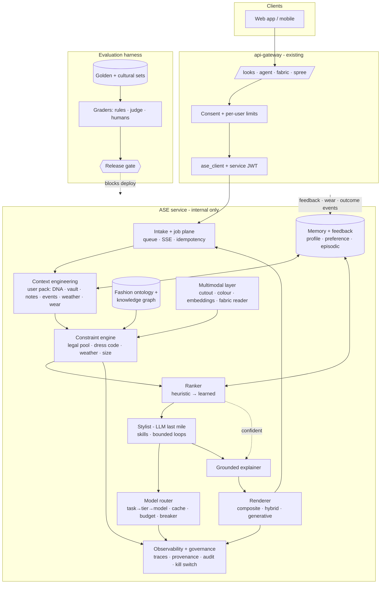

### 2.1 Request lifecycle (look generation)

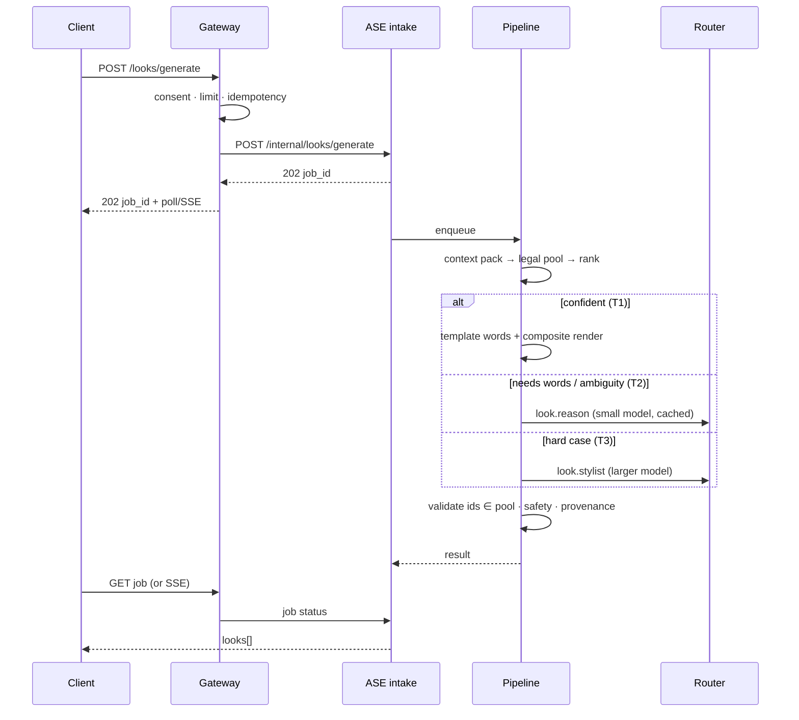

---

## 3. The tiers

A **tier** is a rung of capability and cost. Every task (generate a look, read a fabric, write a sentence) has a ladder; the router climbs only when the lower rung is not confident or not allowed. These tiers sit *above* the model-plane tiers in `models.yaml` (`reasoning`, `fast`, `vision`, `cheap_bulk`): T2 and T3 below resolve to those.

| Tier | What runs | Typical latency | Unit cost *(estimate)* | Target share of AI requests |
|---|---|---|---|---|
| **T0 — Cache / precompute** | Precomputed daily edit, shared archetype looks, cached fabric reads, cached "why" lines, weather per cell | 5–50 ms | ~$0 | 30–40 % |
| **T1 — Deterministic + learned** | Ontology lookup, constraint engine, colour maths, stored embeddings, ranker, template wording, composite render | 50–400 ms | $0.00003–0.0001 (CPU) | 35–45 % |
| **T2 — Small model** (`fast` / `cheap_bulk`) | Short wording, tie-breaks between near-equal candidates, intent classification, tagging | 0.4–1.5 s | $0.0002–0.0006 | 15–25 % |
| **T3 — Large model** (`reasoning` / `vision`) | Fabric reading from an unseen photo, fabric-to-style reasoning, novel or culturally ambiguous requests, spree open chat | 1.5–6 s | $0.002–0.01 | 3–8 % |
| **T4 — Generative image** | Photoreal render, fabric-to-sketch for a tailor brief | 8–30 s | $0.02–0.05 per image *(estimate)* | 1–3 %, always limit-counted |

Rules of the ladder:

- **T0 before everything.** Compute is spent only on a cache miss.
- **Escalate on low confidence, not on guessed difficulty.** Each tier returns a confidence; below the task's threshold the next tier runs.
- **T4 is opt-in and counted.** It is never the default (§12 asks for an ADR superseding ADR 0018 on this).
- **Failure falls *down*, not over.** If a tier is unavailable or over budget, the request is served by the tier below (template, composite) and the response says so.

---

## 4. Section LLDs

Each section has: purpose, low-level diagram, interfaces, data, failure behaviour, and how it is tested. Section order follows the layers you listed.

### 4.1 Intake and job plane

**Purpose.** Accept work from the gateway, return fast, run slow work off the request path, and make every job idempotent and resumable.

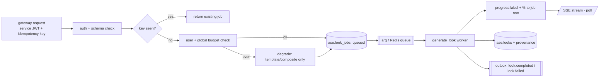

- **Interfaces:** the internal routes already declared in `ase.internal.v1.yaml` (generate, jobs, regenerate, adjust, agent/today, fabric/suggest, embeddings, spree, admin). No new public surface.
- **Job states:** `queued → analyzing → assembling → rendering → done | failed` — the states the web app already renders. `failed` always carries `reason_code` and `stage`, and `counted: false` when the failure was ours.
- **Idempotency:** gateway-supplied key; a retried request returns the same job.
- **Failure behaviour:** worker crash → job re-queued with an attempt count; after 3, `failed(reason=internal)`, **not counted** against the user's limit.
- **Tests:** contract tests against the OpenAPI file; a chaos test that kills a worker mid-job.

### 4.2 Context engineering

**Purpose.** Build, once per request, the *context pack*: the smallest, cleanest set of facts the downstream stages need. This is the single place where privacy, relevance and token cost are controlled.

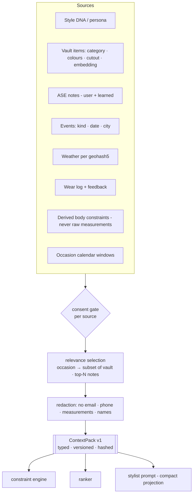

- **ContextPack** is a typed object with a `schema_version`, a content hash (cache key) and a `provenance` list of contributing sources. Missing sources are explicit (`weather: null, reason: no_consent`), so no stage guesses.
- **Prompt projection:** the pack is projected to the smallest text form for a model (item ids and attribute tags, not photos or prose). The token budget per task is enforced here.
- **Weather** is the cell-level context the gateway now serves (`/me/context`) and ASE reads through `context/weather`, cached per `(geohash5, hour)`.
- **Cold start:** with an empty vault the pack carries DNA + occasion only, which routes to **archetype looks** (§4.7) instead of failing.
- **Tests:** property tests that no PII fields can appear; golden snapshots of projections.

### 4.3 Fashion ontology and knowledge graph

**Purpose.** The moat. A reviewed, versioned model of African (and global) fashion: what things *are*, what they *go with*, and what is *appropriate when*. Rules and ranking read this; prompts do not carry it.

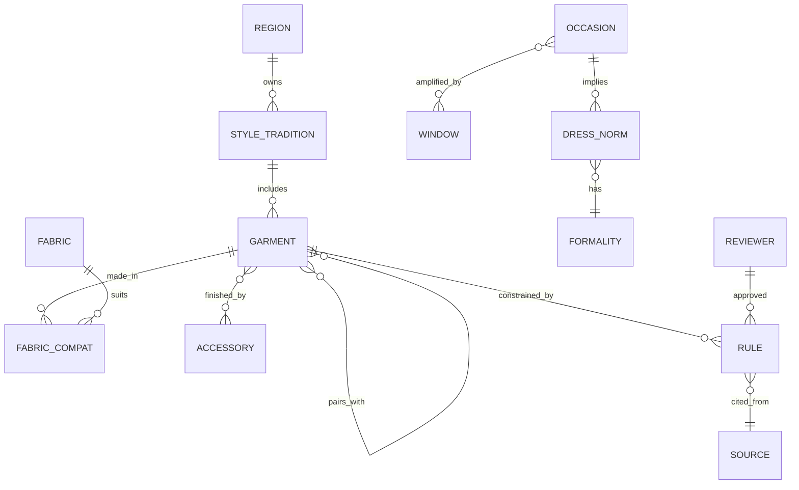

**Entity classes (v0 scope).** Garments (buba, sokoto, iro, gele, agbada, kaftan, senator, boubou, wrapper, corset, …), fabrics (aso-oke, ankara, adire, lace, george, brocade, kente, …), accessories (cap/fila, gele, beads, coral, bag, shoes), occasions (the eight in `context/occasions.py`), formality levels, regions and traditions (Yoruba, Igbo, Hausa, Edo, Efik/Ibibio, Ghanaian, Pan-African, diaspora), and windows (harmattan, Detty December, lunar windows).

**Rule form.** Every rule is data: `{id, subject, predicate, object, strength: hard|soft, region?, occasion?, source, reviewer, reviewed_at, version}`. Hard rules feed the constraint engine; soft rules become ranker features.

**Governance of culture.** Rules without a named reviewer and source are not loaded. Disputed or region-specific norms are `soft` and region-tagged, never encoded as universal. A change log and a quarterly review with native-speaking stylists are part of the release gate (§10.5).

- **Storage:** Postgres tables in the `ase` schema (it already declares `style_library`, `compatibility_rules`, `accessory_pairings`; extended with ontology tables), loaded into an in-memory graph at start (thousands of nodes) and versioned by content hash.
- **Tests:** consistency checks (no cycles in `pairs_with`, no hard-rule contradictions), coverage report per occasion, and every rule exercised by at least one eval case.

### 4.4 Multimodal intelligence

**Purpose.** Turn pixels into structured, cheap-to-use facts once, at upload time — never per request.

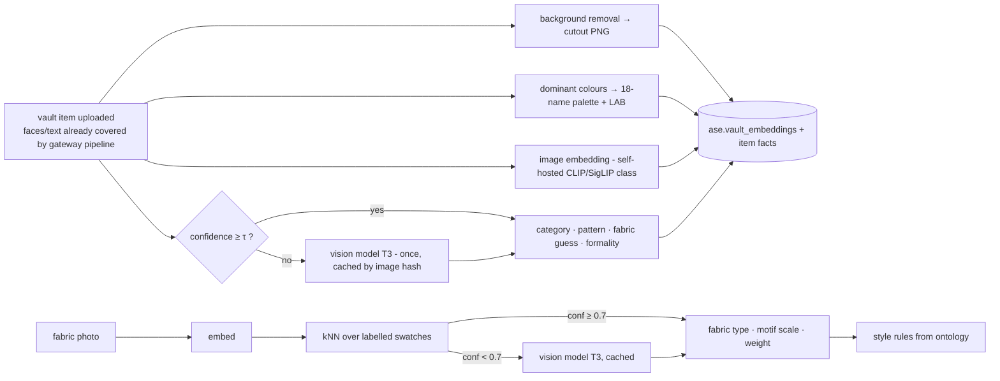

- **Cutouts** power the compositor (§4.7) and are why T1 can render for free.
- **Colour:** the on-device suggestion in the web app is a hint; ASE recomputes server-side and stores LAB plus the nearest palette name, so the two never disagree silently.
- **Embeddings:** one model id at a time per index (partial HNSW index per `model_id`); migration is dual-write → shadow-evaluate → flip (LLD §8).
- **Cost control:** everything here is per-item and per-image-hash cached; a re-uploaded identical photo costs nothing.
- **Tests:** labelled swatch set (`fabric_match`), colour ΔE tolerance tests, embedding regression test against a fixed neighbour corpus.

### 4.5 Constraint and ranking engine

**Purpose.** Produce a small set of *valid, good* candidate looks without a language model.

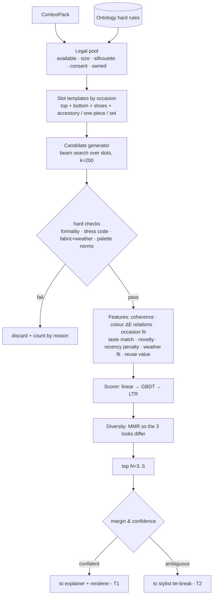

- **Why this can beat an LLM assembler on cost and often on quality:** the pool is small (a wardrobe), rules are explicit, and the scorer learns from *this* user's wear and feedback. A model adds value on ambiguity and wording — what T2/T3 buy.
- **Scorer ladder:** (1) hand-weighted linear using the `scoring.py` features that already exist, (2) gradient-boosted trees on feedback and wear logs, (3) listwise learning-to-rank once there is enough data. Each step must beat the previous on the offline set before replacing it.
- **Cold-start prior:** blended `dna / aspiration / behaviour` weights from LLD §3; weights are config, not code.
- **Output:** `CandidateLook {item_ids, slot_map, features, score, confidence, violated_soft_rules[]}`.
- **Position bias:** every served look is logged with position and candidate-set hash into `ase.look_impressions` (per `ai-quality.md` §5) so the learned ranker can be debiased.
- **Tests:** deterministic; 100 % branch coverage on pool and hard checks (existing standard); metamorphic tests (adding an irrelevant item must not change the top look).

### 4.6 Skills, loops and the stylist (LLM last mile)

**Purpose.** Use a model where judgement or language is genuinely needed, with bounded, inspectable behaviour.

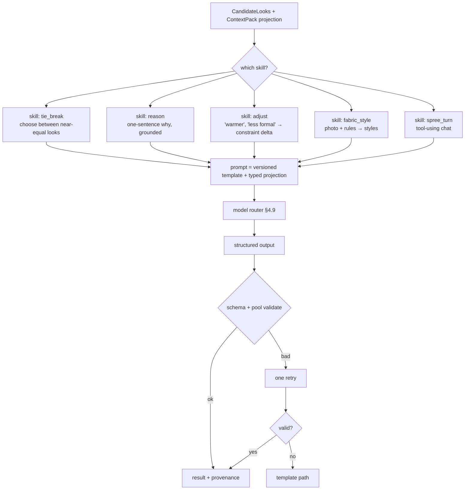

- **Skills are code, not prose.** A skill has an input type, output schema, prompt template version, allowed read-only tools, token cap, tier, template fallback and its own eval set. New behaviour is a new skill with a new eval set, not a longer prompt.
- **Loops are bounded.** Spree: ≤ 4 tool rounds, ≤ 8 calls, 30 s (the constants already in `spree/tools`). Look generation has **no agentic loop** by default: one pass, at most one retry.
- **Adjust** turns language into a *constraint delta* ("warmer" → raise fabric-weight preference, lower formality) and re-runs the engine. The model never edits the outfit directly, so validation stays true.
- **Tests:** recorded-provider unit tests (no real calls in CI), schema fuzzing, the injection suite for untrusted text (`spree_safety`).

#### 4.6.1 Skills are a phased pipeline skill with reference files

*(Added 2026-10-16 at the owner's direction.)* Skills are not loose prompt strings. Each skill is a folder with a short entry file and **phase files that name the reference files they need**, so a request loads only the phase it is in and the references that phase lists.

```
ase/skills/
  look-pipeline/                    the phased pipeline skill
    SKILL.md                        entry: purpose, phase order, tier policy, stop conditions, outputs
    phases/
      01-context.md                 build the ContextPack                      (T1)
      02-pool.md                    hard filters: the legal pool               (T1)
      03-rank.md                    slots, candidates, score, diversity        (T1)
      04-words.md                   tie-break + one-line reason                (T2, template fallback)
      05-render.md                  composite | archetype | hybrid | generative
      06-validate.md                ids in pool, safety, provenance
    references/
      ontology/                     occasions.md  dress-norms.md  fabrics.md  windows.md
      colour-rules.md  slot-templates.md  rubric-grounding.md  tone-and-voice.md
      schemas/                      context-pack.json  candidate-look.json  look.json  provenance.json
      examples/                     golden-*.jsonl
    scripts/                        deterministic helpers a phase may call
    evals/                          the sets this skill must pass (links into eval-sets/)
  fabric-style/                     same shape
  spree-chat/                       same shape, with the tool and loop limits
```

Rules:

1. **One skill, ordered phases.** `SKILL.md` lists the phases and their order. A phase file states: goal, input schema, steps, tier and template fallback, **the reference files to load**, output schema, exit checks, and the eval set that covers it.
2. **Progressive disclosure.** The runner loads `SKILL.md` (small), then only the active phase file and the references it lists. Nothing else is in the prompt. This is a cost control as well as a clarity one: tokens are spent only on what the phase needs.
3. **Deterministic phases carry no prompt.** Phases 01 to 03 and 06 are code that reads their reference files as data (ontology, slot templates, colour rules). Only phase 04 (and 05 when generative) calls a model.
4. **References are governed data.** Every reference file has front matter: `owner`, `reviewer` (named, for cultural content), `source`, `version`, `reviewed_at`. A reference without a reviewer is not loaded.
5. **Versioned and attributable.** A skill's version is the content hash of its folder. The provenance record stores the skill version, the phase versions and the hash of each reference actually loaded.
6. **Evaluated per phase.** Each phase is covered by an eval set, and a change to any file in the folder triggers the offline suite (section 10).
7. **Same shape for every skill**, so a new skill is a new folder with the same layout rather than new plumbing.

**Built (2026-10-21).** `ase/skills/` holds four skills in this shape: `look-pipeline` (six phases), `adjust` (three), `fabric-style` (three) and `spree-chat` (five). The loader (`ase/app/skills/loader.py`) checks every folder at load: handlers may only point inside `app.skills`, a model phase must name a router task and a fallback, untrusted variables may sit only inside the user `<data>` block, and a reference without a named reviewer is refused outside development. The runner (`runner.py`) loads only the active phase's listed references and returns a provenance record (folder hash, phase hashes, whether code, model, cache or template answered, hash of each reference loaded). `LookService` runs `look-pipeline` for generate, regenerate and adjust, and `adjust` turns free words into a bounded delta (temperature, one formality rung, colours to avoid or prefer) before the engine runs again. `spree-chat` runs the guard chain (input, injection, intent, grounding, output, budget) around a bounded tool loop (4 rounds, 8 calls, 30 s, read-only tools only) behind `POST /internal/spree/sessions/{id}/messages`.

Migration note: `docs/60-ai/prompts.md` already versions prompt files. Under this layout those prompts become the model-calling phase files, and the shared knowledge they carry moves into `references/`.

### 4.7 Rendering

**Purpose.** Show the look: cheapest faithful method first; generation only when it buys something compositing cannot.

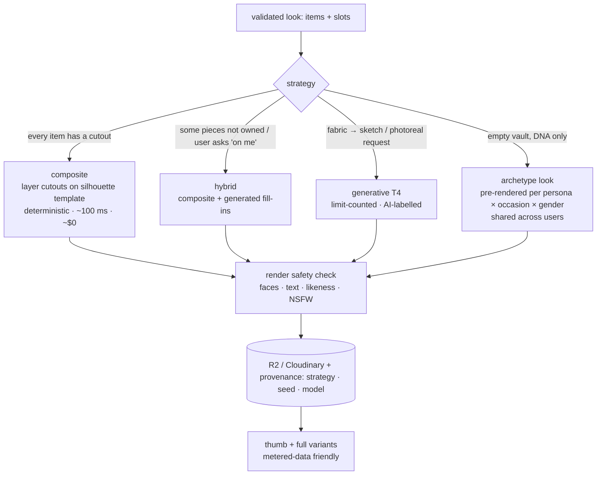

- **The cold-start answer.** ADR 0018 chose generative because the first session has an empty vault. **Archetype looks** solve that without a per-user image bill: pre-render a reviewed library once (persona × occasion × gender × a few variants) and serve it from cache. A first-session user sees complete, on-brand looks at ~$0 marginal cost; the cost is a one-off batch.
- **Labelling.** Anything generated is flagged `generated_by_ai` (already in the web contract) and stamped with provenance.
- **Tests:** visual regression on composites (pixel diff with tolerance), `render_safety` set, cost per look tracked per strategy.
- **Sample:** a code-drawn sample of the composite output, with the slot template, layer order, result card and provenance record, is at `/dev/composite` in the web app (development only, not served in production).

#### 4.7.1 Extracting one piece, and seeing it on a body

*(Added 2026-10-16.)* Two separate capabilities, with different difficulty.

**Extract one piece from a busy photo (feasible now, T1).** A promptable segmentation model (MobileSAM, MIT licence, 28 MB encoder plus 16 MB decoder) reads the photo once and turns the person's taps into a mask: tap the shoe, get just the shoe. Verified on-device on the review page (`/dev/composite`, "Try it with a real photo"): one tap isolated a single boot from a flat-lay of several items. The cut-out, its colours (read from the piece only) and a quality verdict come from the same shared step as the automatic path. In production the encoder and decoder run in the upload worker, the cut-out is stored once with the item, and a low-confidence mask falls back to asking for a retake or another tap. Known behaviour: one tap returns the smallest sensible part (a watch face, not the strap), so the person adds taps for other parts.

**Put it on a realistic body that matches the person (feasible, T4, not built).** This is virtual try-on: a model draws the piece on a body, with drape and shadow.

| Route | What it needs | Notes |
|---|---|---|
| A. The person's own photo | A full-body photo, opt-in, short retention, never used for training | Most realistic; highest privacy sensitivity |
| B. A model matched to their body type | A pre-rendered library of base models across build, height, skin tone, gender presentation; the body profile picks the nearest | **Recommended first.** No personal photo; bases are reused by everyone |
| C. A measured 3D avatar | 3D garments, which one photo cannot give | Later; the route to real size and fit checks for the tailor brief |

Limits to design around:

1. **Garments first.** Try-on models handle tops, bottoms, dresses and native wear well. Shoes and small accessories are weak (orientation, perspective): use a 2D composite with a keypoint-based placement until a model proves itself on a shoe evaluation set.
2. **Looks, not sizing.** A try-on render shows style and drape on a body shape. It does not prove a size fits. Size guidance stays measurement-based.
3. **Cost and tier.** Each render is a generative image (T4): limit-counted (2 per day proposed), labelled `generated_by_ai`, cached by (item, base model, pose). Planning estimate about $0.04 to 0.08 per image from a commercial service.
4. **Licence.** Several open try-on models are non-commercial. Use a commercial service or confirm the licence before building on one.
5. **Fairness gate.** Generative models can render some skin tones and body types worse. The evaluation harness needs a try-on set stratified by body type and skin tone, with a pass threshold in every cell, before launch (section 10).
6. **Likeness.** Base models are synthetic or licensed; no real person's likeness is generated without that person's explicit consent.

#### 4.7.2 Photos of a person wearing the outfit

*(Added 2026-10-17.)* A vault upload may be a photo of the user wearing the outfit. Cutting a clean piece out of that photo is unreliable, so the design does not depend on it.

**Why it is hard.** Layers and occlusion (a jacket hides the shirt; an agbada sits over a tunic and trousers; hands and bags cover pieces). Pose and drape bend shapes and patterns. Cropped photos and mirror selfies cut pieces off. Wrapped and tied pieces (iro, gele) have no stable outline. Lighting shifts colour. A cut-out from a worn photo has body-shaped gaps and rarely looks like a product shot in a composite. Segmentation models are the most likely to under-perform on darker skin and on native wear. The photo also contains a face, a body and possibly other people.

**Decision: attribute first, pixels second.** The item record is the source of truth; the photo is evidence for it.

| Upload class | Kept | Used in renders |
|---|---|---|
| Item photo (flat-lay, hanger) | cut-out and attributes | composite pixels, if the quality gate passes |
| Worn photo | attributes, plus a face-free garment crop for the user's own vault view | drawn from the garment glossary, fabric catalogue and prompt builder (4.7.4); the user's pixels only if the gate passes |
| Several pieces in one photo | one record per piece the user confirms | as above |
| Unusable | the image hash only; the user is shown guidance | none |

1. **Classify at upload.** A small vision model sorts the photo into the four classes above, once, cached by image hash.
2. **Read attributes.** Garment type, colour, pattern, cloth (as a fabric-catalogue id with a confidence), cut. These create the vault item, so the vault stays useful when extraction fails.
3. **Guided extraction.** Show what was found as chips (for example "agbada, white fila") and let the user confirm, assign slot and layer, or tap to select (the promptable segmentation of 4.7.1).
4. **Quality gate, three outcomes.** Clean cut-out, attributes only, or ask for a better photo with a short guide (lay it flat or hang it on a door, in daylight).
5. **No generative fill on the user's clothes.** Inpainting hidden parts would invent details and break the promise that these are the user's actual clothes.
6. **Privacy.** Detect and blur or crop faces before anything leaves the device or our worker. Extraction runs on-device or in our own worker; nothing goes to an external model without the explicit opt-in. Keep only the garment crop and attributes by default and delete the original after extraction unless the user chooses to keep it. Warn about other people in the photo; treat anything that appears to show a minor as restricted. The audited staff-review rules apply unchanged. Using a worn photo for virtual try-on (route A above) is a separate, explicit consent.
7. **Evaluation.** A new `worn_extraction` set (section 10.3): consented worn photos across lighting, skin tones, garment types (agbada, iro, gele, kaftan, jeans) and occlusion levels. Report usable-cut-out rate and attribute accuracy in every cell, and gate pixel use in renders on it.

*ADR to write:* "Attribute-first rendering; user pixels only when quality-gated."

Related risks: wrong auto-tags (needs an easy correction loop), duplicates, brand logos in photos, per-upload cost and latency, and weak connectivity (queue and retry).

#### 4.7.3 Style catalogue (the base sample catalogue)

*(Added 2026-10-17. Images are paused until sources are agreed; the text catalogue can start now.)* A reviewed pool of styles that the first view and the expander draw on, so a new user with an empty vault sees varied, culturally correct looks.

**Build it, and use search only to find things.** Images from a general image search are almost all copyrighted and the engines' terms generally forbid storing them. Feeding them to a generator as references also risks output that sits too close to someone's design. Search is for discovery and facts (what a garment is, who wears it, what exists to license), through licence-aware sources such as Wikimedia Commons and Openverse, and every candidate is recorded with its licence. Share-alike and non-commercial licences stay out of production until legal review.

| Stage | Content | Cost and risk |
|---|---|---|
| 0. Text cards (start now) | description, tradition, garments, cloth ids, silhouette, palette, occasions, personas, weather, named reviewer; about 40 to 60 cards across the main traditions and the persona by occasion grid | near zero; no image rights involved; feeds the prompt builder and expander directly |
| 1. Images, from shippable sources | own shoots with tailors and partners (signed releases); commissioned illustrations; curated self-generated references, flagged as such; openly licensed files (CC0, public domain, CC BY with attribution recorded); partner designers who opt in and are credited | licence and consent work per item |
| 2. Use | retrieval for the first view (archetype looks, 4.7) and for the expander; then reference conditioning, tested as an A/B on the pilot cases | about 15 to 20 percent more per image when a reference is sent (FLUX.2 Klein input tiles); archetype batches run once, offline |

**Card fields.** `id, name, tradition, region, garments[], cloth_ids[], silhouette, palette, occasions[], personas[], gender, weather, references[] (file, source, author, licence, date, content hash), reviewer, status, inspired_by`.

**The InFashAI pool (research only).** InFashAI v1 (Hacheme and Sayouti, 2021; github.com/hgilles06/infashai) is about 15,700 boutique product photos of African fashion with titles, prices and descriptions, plus a Western DeepFashion subset. It is indexed locally for search by `ase/eval/infashai.py` (SQLite full-text index; phone numbers, e-mail addresses, links and handles are scrubbed at index time; DeepFashion rows are hidden by default). Use it to mine vocabulary, count what exists and help reviewers write our own cards. **Do not** serve it to users, use it as reference images, train on it, or put seller or designer names in prompts: the repo lists GPL-3.0 (a software licence), the paper gives the data no licence, the photos are third-party listings that show identifiable people, and DeepFashion is non-commercial. Every fetched file is recorded as `research_only_unverified` with its hash. Coverage is uneven: strong for ankara (about 9,000 hits), dashiki, kente, bogolan, boubou, kaftan, adire and agbada (hundreds each); thin for fila (17), buba (24), aso oke (about 30), iro (9) and gele (4), so it will not fill our weakest gaps. Images are fetched through the paginated Drive API (the public listing is truncated at about 5,500 files) or `rclone`, with md5 and decode checks, a size cap and a stop on quota; the images are a worn-photo set, so they are candidate material for the `worn_extraction` eval (4.7.2) once their use is cleared.

**Guardrails.** A named reviewer from the tradition approves each card. A render is rejected if it is too similar to a single reference. Prompts never contain a designer's name. Variance between runs is controlled with a seed before arms are compared. Outputs are checked across body types and skin tones.

#### 4.7.4 Render prompting and the first pilot (2026-10-16)

**What exists** (`ase/`, all uncommitted, 55 unit tests passing):

- `app/fabric/fabrics.yaml` and `catalogue.py`: 24 cloths, each described by how it photographs (look, drape, sheen, what to avoid), with whole-word alias matching and a weather-aware default.
- `app/models/render/garments.yaml`: 29 garments (agbada, fila, buba, iro, gele, kaftan, senator top, asoebi gown and others), each with shape, details and the look-alikes it must not become.
- `app/models/render/prompting.py`: the v3 builder. It turns a look spec into a prompt from structured fields only, resolves each cloth in the order given, named in the item, chosen by the expander, glossary default, and records where every fact came from. Per-format templates for composite, archetype and generative; automatic trimming to a length cap; a guard that rejects banned words and instruction-like text.
- `app/models/render/expander.py` and `app/prompts/render.expand/v1.md`: the optional LLM expander. It fills only gaps (a description for a garment the glossary lacks, a cloth for an item with none, one mood line), must answer in a fixed JSON shape, and every field is validated. A bad answer falls back to the plain prompt. It makes no network call itself.
- `ase/eval/render_pilot.py` and `docs/60-ai/eval-sets/render_pilot/cases.jsonl`: the pilot runner and 14 cases (5 composite, 5 archetype, 4 generative).

**Expander model.** On Workers AI, nine models were compared on seven gap-filling inputs. Mistral Small 3.1 24B, gpt-oss-20b and Llama 4 Scout tied at 0.98; Mistral was the fastest (about 2 s, about 66 output tokens, no hidden reasoning). Reasoning models spent 1,000 or more tokens and often returned nothing usable. GLM 5.3 Flash and DeepSeek V4 Flash are not on the Workers Free plan. Recorded in `app/models/config/models.yaml` as `render.expand`.

**First image pilot** (FLUX.2 Klein 4B on Workers AI, prompt v2, 14 cases; labels by a single model reviewer, a person should re-score):

| Measure | Result |
|---|---|
| Layout correct | 14 of 14 |
| Right pieces | 9 of 14 |
| Culturally right | 8 of 14 |
| No faces | 14 of 14 |
| No labels or writing | 10 of 14 |

Strong: senator tops, an ankara print with a gele fan (when the expander chose the cloth), a kaftan, a lace gown. Weak: agbada (no robe), fila, gele in flat-lays, adire (drawn as a plain blue dress), aso oke (never woven strips), an ankara shirt with no print. The model knows ankara and lace; it does not know the other cloths. Prompt detail alone did not fix those.

**Vision judges** against the reviewer's labels: Mistral Small 11 of 14 on pieces, 14 of 14 on faces, 11 of 14 on text; Llama 4 Scout 11 of 14, 14 of 14, 13 of 14 (but slower, and it needs images shrunk to 640 px); LLaVA 1.5 7B 8 of 14, 11 of 14, 11 of 14, and it invents people. Plan: Mistral for pieces and layout, Scout as the label check, and sampled human review.

**Findings that change the design.**
- Inner neck labels with garbled writing appear on flat-lays. FLUX.2 Klein has no negative prompt, so "no labels" cannot work; a positive wording ("every neckline is bare fabric with nothing sewn in") removed it in one of two tests. Add a label check with a zoomed crop.
- A reference photo reshaped a piece the model already draws (a bow headband became a pleated gele fan on the mannequin) but could not force a missing piece into a crowded flat-lay. References need licences (4.7.3).
- Results vary run to run. Pass a seed where the provider allows it before comparing arms.
- Cost, in Workers AI Neurons (10,000 free per day): about 104 per image, about 41 per Mistral judge call, about 39 per expansion. A full 14-case run is roughly 2,500 to 3,000.

### 4.8 Memory and feedback engineering

**Purpose.** Make ASE learn each person and be able to say *why* it suggested something, from stored facts rather than a fresh prompt.

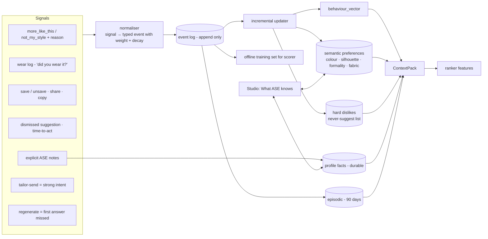

- **Three tiers** (kept from the LLD): profile facts (durable, user-editable), semantic preferences (learned, decayed), episodic (90 days). The *What ASE knows* page in the web app is the user's view of exactly this store; edits and forgetting must take effect at once.
- **Reasons matter.** "Not my style: too formal" updates the formality preference, not just the item. The web app already collects the reasons.
- **Negative memory is cheap and powerful.** A hard dislike removes candidates before ranking, so the same mistake is never repeated and no model is needed.
- **Exploration.** A small, bounded exploration rate (for example one of three looks is a mild stretch) stops the profile collapsing into a rut; exploration outcomes are logged separately so they do not poison training.
- **Privacy.** Consent revocation drops derived state immediately (events rules in `events.md`); deletion purges everything ASE owns and acknowledges with `user.deletion.completed`.
- **Tests:** replay tests (a recorded signal stream must reproduce the same preference state), decay tests, "forget this" tests.

### 4.9 Model routing and inference optimisation

**Purpose.** One place that decides *which model, at what cost, with what fallback*, and enforces the budget. This extends the sequence already specified in `model-plane.md`.

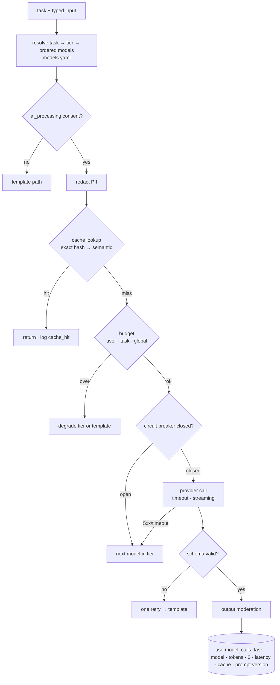

Optimisations, in order of payoff:

1. **Don't call** — T0/T1 cover most traffic (§3).
2. **Cache** — exact-key cache on `(task, context-pack hash, prompt version)`; semantic cache only for low-risk wording tasks.
3. **Batch and precompute** — the daily edit runs overnight through batch endpoints (typically about half the price) with prompt-prefix caching.
4. **Right-size** — the smallest model that passes the skill's eval; larger models only on escalation.
5. **Shrink tokens** — typed projections instead of prose, item ids instead of descriptions, structured output.
6. **Self-host the cheap parts** — embeddings, tagging and cutouts on a small box have near-zero marginal cost and no per-call price.
7. **Stream** — send the composite and the sentence as soon as each is ready (SSE), so perceived latency is the composite's, not the model's.

`models.yaml` holds placeholder slugs on purpose; §11 lists what to fill in and the new budget numbers.

### 4.10 Evaluation and harness engineering

**Purpose.** Decide, with evidence, whether an output — and a change — is good enough to ship. Detail in §10.

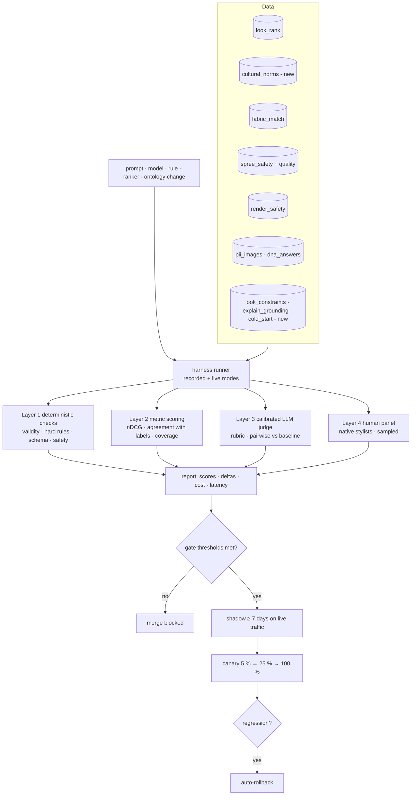

### 4.11 Agent harness, observability and governance

**Purpose.** Operate ASE safely: see everything it does, control it live, and prove what it did.

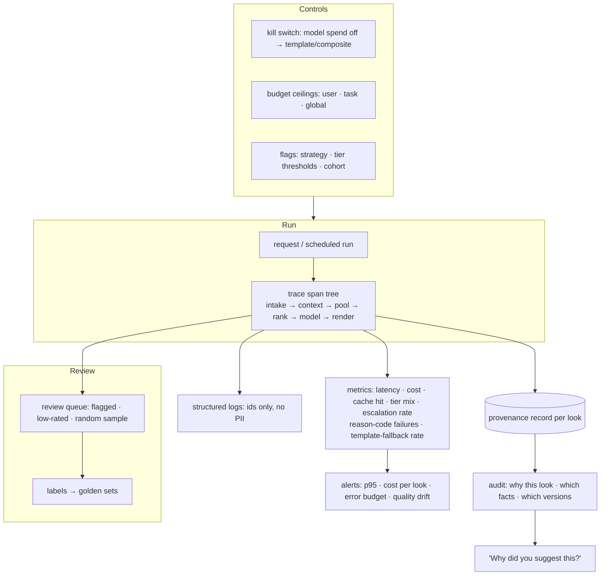

- **Provenance record** (per look, immutable): `ontology_version`, `rules_fired[]`, `ranker_version`, `model_ids[]`, `prompt_versions[]`, `context_pack_hash`, `render_strategy/model/seed`, `cost_usd`, `latency_ms`, `tiers_used[]`, `guardrail_verdicts[]`. It generalises the `model_id / prompt_version / strategy_version / renderer` attribution already required by `ai-quality.md` §3.
- **Tooling:** Langfuse for traces, prompt versions, cost and eval runs (already the chosen tool, `ai-quality.md` §8), plus OpenTelemetry for the service.
- **Kill switch** is operable without a deploy (in the admin API); exercise it in a game-day each quarter.
- **Governance:** ADRs for any mutating spree tool, any new data source, any new model vendor; a processing-register entry per vendor (zero-data-retention and no-train flags already in `models.yaml`).

---

## 5. Cost model

**Budget:** about **$50 per 1,000,000 API requests** *(your target)* — $0.00005 per request averaged over all requests. Most requests are reads that never touch AI, so the number to manage is **cost per AI-bearing request**, tracked per type.

### 5.1 Planning mix *(assumption — replace with real traffic)*

| Request type | Share of 1 M | Count | Tier mix | Unit cost *(estimate)* | Allocation |
|---|---|---|---|---|---|
| Reads: feed, vault, search, home, history | 90 % | 900 k | none | ~$0 AI | $0 |
| Look generation (vault → looks) | 6 % | 60 k | 40 % T0 / 40 % T1 / 15 % T2 / 5 % T3 | ≈ $0.00033 | **$20** |
| Daily edit (precomputed overnight, batch) | 2 % | 20 k | T1 + batch T2 | ≈ $0.0002 | **$4** |
| Fabric read / style | 1 % | 10 k | 60 % cache/kNN, 40 % T3 | ≈ $0.0012 | **$12** |
| Spree chat turn | 0.5 % | 5 k | T2 first, T3 on escalation, strict caps | ≈ $0.002 | **$10** |
| Embeddings / tagging (upload-time) | — | — | self-hosted | — | **$2** |
| Evaluation + shadow traffic | — | — | recorded where possible | — | **$2** |
| **Total** | | | | | **≈ $50** |

Derivation of the look line *(estimate)*: 0.40 × ~$0 (cache) + 0.40 × $0.00005 (CPU) + 0.15 × $0.0004 (small model, ~800 in / 150 out) + 0.05 × $0.004 (large model) ≈ **$0.00028–0.00035** per look.

The budget **excludes** hosting (API, workers, database, queue, an optional small GPU/CPU inference box) and image-generation spend, which is limit-counted and budgeted separately.

### 5.2 What breaks the budget

| Pressure | Effect | Defence |
|---|---|---|
| Generative render per look | $0.02–0.05 × 60 k = $1,200–3,000 | Composite + archetypes by default; T4 only on request and counted |
| One LLM call per request | $0.001–0.002 × 1 M = $1,000–2,000 | Reads never call AI; T0/T1 first |
| Unbounded spree | A 4-round tool loop is 4–8 calls | Round/call caps, per-user daily turn cap, templated refusals with no spend |
| Embedding migration | Re-embed all vaults | Dual-write, scheduled, self-hosted model |
| Evaluation on live models | Eval runs are not free | Recorded-provider mode by default; live runs on a schedule |

### 5.3 Per-user limits (enforced in the gateway and the router)

| Limit | Proposed default | Reason |
|---|---|---|
| Look generations / day | 10 (free), higher for paid | Matches the limit state in the UI; failures never count |
| Photoreal renders / day | 2 | T4 is the expensive tier |
| Fabric reads / day | 5 | Vision tier |
| Spree turns / day | 30 | Bounded chat |
| Hard per-user AI spend / day | **$0.02** *(replaces $0.50 in `models.yaml`)* | $0.50 lets one user cost what 10,000 requests are budgeted for |
| Global monthly ceiling | derived from active users × per-user budget | Auto-degrades to T1/templates when hit |

The user sees a calm limit state; the system sees a degradation, not an outage.

### 5.4 Unit economics the harness reports weekly

cost per look · cost per active user per month · tier mix · cache hit rate · escalation rate · template-fallback rate · T4 renders per 1,000 looks.

---

## 6. Speed targets

| Path | Target |
|---|---|
| Read endpoints | p95 < 200 ms |
| Look, cache/archetype hit (T0) | p50 < 300 ms |
| Look, deterministic (T1) | p50 < 1.2 s, p95 < 2.5 s |
| Look with small model (T2) | p95 < 4 s |
| Fabric read | p95 < 6 s |
| Photoreal (T4) | job + progress, p95 < 30 s |
| Time to first visible progress | < 400 ms (SSE `queued` / label) |

---

## 7. Data contracts ASE owns

| Object | Producer | Consumers | Notes |
|---|---|---|---|
| `ContextPack` | context engineering | engine, ranker, stylist | typed, hashed, PII-free |
| `CandidateLook` | engine | ranker, stylist | includes violated soft rules |
| `Look` | pipeline | gateway, web app | items with `vault_item_id`, `why_this_works`, `generated_by_ai` |
| `Provenance` | all stages | audit, "why this?" | immutable |
| `FeedbackEvent` | gateway | memory | typed, weighted, decayed |
| `ModelCall` | router | observability, cost | no prompt text beyond hash + version |

---

## 8. Security, privacy and safety constraints

1. No identifiers beyond `user_id` inside ASE; no measurements to any model (sizes become derived constraints only).
2. Consent checked at the router for every AI call; revocation is immediate and destructive for derived state.
3. Untrusted text (user notes, OCR from images, pin titles) is wrapped, classed and never concatenated into instructions (ADR 0014).
4. All spree tools are read-only; adding a mutating tool needs an ADR.
5. Vendors: zero-data-retention and no-train enforced per request; recorded in the processing register.
6. Output guards: body commentary, medical claims, promises and PII echo are blocked and counted.
7. Generated imagery is labelled, stamped with provenance, and never presents an AI likeness as a real person.

---

## 9.0 State on 2026-10-21 (supersedes the table below, which is the 2026-10-15 review and kept for the record)

| Area | State |
|---|---|
| Engine (pool, hard rules, beam search, ranker, validation, grounded explanations) | **Built.** `ase/app/engine`, reviewed rules in `ase/app/ontology`, 14 style cards in `ase/app/archetypes` (all drafts until reviewers approve them) |
| Skills | **Built.** `look-pipeline`, `adjust`, `fabric-style`, `spree-chat` in `ase/skills`, loader and runner in `ase/app/skills`, provenance on every job |
| Job plane | **Built, on Postgres.** Idempotent, attempts capped at 3, failures not counted, ownership enforced, impressions logged (`ase/app/workers/jobs.py`, `ase/app/store.py`, faue-db migration 0026) |
| Model plane | **Built.** `ModelRouter` with consent, redaction, cache, budgets, per-model breaker, fallback, template path, kill switches read from the database, every call logged to `ase.model_calls`. Providers: Workers AI and OpenRouter. Only `fast` (Mistral Small 3.1) and `vision` (Llama 4 Scout) tiers name a real slug; the rest are placeholders, so those tasks use templates |
| Memory and feedback | **Built.** Signals, decay, reasons, never-suggest, exploration kept apart, forget, erase, consent revocation, user-written facts (closed set of keys); fed into every look. Consumes `consent.changed`, `user.deletion.requested` and `vault.item.removed` (`python -m app.workers.events`) |
| Spree chat | **Built.** Six read-only tools, JSON tool protocol, guards, budgets, redacted transcripts deleted after 30 days. Single-body reply (no SSE yet); attachments refused until uploads are classified |
| Proactive suggestion | **Built.** `POST /internal/agent/today`, one run a day, outcomes feed memory |
| Upload intelligence | **Partly built.** Colours from a photo (suggestion only), cut-out quality gate. **Not built:** neural embeddings, kNN fabric match, vision-model tagging (need the hosted embedding and vision choices) |
| Review gate | **Built.** Cards, rules and skill references are filed in the admin review queue by hash; production loads only approved versions (`ase.approved_content` view) |
| Admin | **Built.** Styling-engine page: health, spend by task, kill switch, review sync. Reviewer management and the queue were built earlier |
| Evaluation | **Built.** Six deterministic suites with gates (`ase/eval/runner.py`, run in CI by `tests/unit/test_eval_gate.py`): `look_constraints`, `cold_start`, `adjust_instructions`, `spree_safety`, `explain_grounding`, `look_rank`. **Not built:** the model-graded suites (`cultural_norms`, fabric match with labelled swatches, `render_safety`), shadow mode and interleaving; they need reviewers, labelled images and live traffic |

Still waiting on people or accounts, not code: named reviewers for each tradition, stylist rankings to replace the `look_rank` regression anchors, a funded OpenRouter key and real slugs for the `reasoning` and `cheap_bulk` tiers, the hosted embedding choice, licensed reference photos for the render references, and a faue-db release tag that ase and the gateway pin to.

Open cultural question recorded by `look_rank_004`: whether a fila should match the agbada's colour is a decision for the Yoruba reviewers. The engine currently prefers a look without an accessory over one with a contrasting or matching cap, because an optional piece lowers the average pairing score.

---

### 9.0.1 Changes on 2026-10-30

- **look-pipeline gains a `narrate` phase (05).** After `words`, a model (task `look.reasoning`, fast tier) writes each look's reason from the event (kind, name, days away), today's temperature, liked colours, the pieces by the person's own names, which have never been worn, and the colour story, and is told to make the looks read differently from each other. A reason is kept only if `reason_is_grounded` passes: no piece or colour the look lacks, no number except the temperature and the days to the event, no occasion word except the look's own or the event's, none of the banned claims. Otherwise the engine's sentences stand. Phase files are now 01-context, 02-pool, 03-rank, 04-words, 05-narrate, 06-render, 07-validate.
- **The engine's own sentences (`engine/explain.py`) were rewritten.** Thirteen claims, most specific first (an unworn piece, a liked colour, a deliberate contrast, the dressiest piece, the finishing accessory) before the generic ones (occasion, temperature); two or three phrasings each, picked from the look's own pieces; each piece is named in at most one sentence; titles vary by position in the set. Still only facts the engine measured.
- **Context pack accepts `event`** `{kind, name, days_until}`, cleaned and bounded (name at most 60 characters, no contact details). The gateway sends it for the nearest event in the next 14 days that matches the requested occasion; the person's own title only with personalisation consent.
- **Pictures where nothing is owned.** `POST /internal/looks/{id}/image` (archetype looks only; an owned look is 409 because a model could change the garment) and `POST /internal/fabric/style-image`, through `models/render/generative.py` (Workers AI, FLUX.2 Klein) with the same kill switches, budgets and call log as every model call. They answer 424 when a picture cannot be drawn, deliberately not a 5xx, so a missing picture never opens the gateway's circuit breaker for ase.
- **Share cards (gateway).** Look and tailor cards are drawn on request in four shapes (`4x5`, `9x16`, `1x1`, `og`), returned as the download, and never stored. Samples: `sample-output/cards/`.

## 9. What exists today (review of `ase/`, 2026-10-15)

| Area | State | Evidence |
|---|---|---|
| Service skeleton (FastAPI factory, config, auth, docs, Docker, CI) | Present | `app/main.py`, `app/config.py`, `app/auth.py`, `Dockerfile`, `.github/workflows/ci.yml` |
| Internal API | **Declared, not implemented** — every route raises `NotImplementedError` (500) | `app/api/internal/*.py` (looks, agent, embeddings, spree, fabric, admin, context) |
| Engine | **Only `scoring.py` is implemented** (cosine, coherence, context, pairwise); `pool`, `color`, `stylist`, `validate`, `rank`, `explain`, `style_context` are stubs | `app/engine/*.py`; 8 unit tests in `tests/unit/test_scoring.py` |
| Model plane | Interfaces and a router docstring only; `models.yaml` has `<primary>` placeholders; no provider, cache, budget or redaction code | `app/models/` |
| Guardrails | Five guard classes, all `raise NotImplementedError`; tool list and caps defined | `app/spree/guardrails/`, `app/spree/tools/__init__.py` |
| Context | `occasions.py` has the taxonomy and `OccasionSignal`; `signals_for` and lunar resolution are stubs; no weather provider | `app/context/occasions.py` |
| Evaluation | `eval/__init__.py` is empty; `docs/60-ai/eval-sets/` has a README and **no data**; CI runs the shared lint/type/test workflow, **no eval gate** | `eval/`, `docs/60-ai/eval-sets/` |
| Prompts | No `app/prompts/` directory; versioning scheme documented only | `docs/60-ai/prompts.md` |
| Database | `ase` schema tables exist in migration `0001_initial_schema`; **no ORM models** (`faue_db/ase/__init__.py` is 4 lines) | `faue-db/` |
| Events | Catalogue documented; no consumers or producers | `docs/20-services/ase/events.md` |
| Dependency pins | `faue-core@v0.1.0`, `faue-db@v0.1.0` — **behind** the gateway's `faue-db@v0.4.0` | `ase/pyproject.toml` |

**Total real implementation: about 750 lines, one working module.** The design documents are strong and the code is a faithful skeleton, which is a good place to start: nothing needs to be unlearned.

### 9.1 Where the existing design conflicts with this document

| Existing | Conflict | Proposal |
|---|---|---|
| **ADR 0017** — model-led assembly in the hot path (`look.stylist`, `reasoning` tier) | A reasoning-tier call per generation: cost, latency, run-to-run variance | Keep the *principle* (aesthetic judgement is learned, not hand-coded), but make the engine + ranker the default assembler (§4.5) and use the model for tie-breaks and wording (§4.6). New ADR "Tiered assembly". |
| **ADR 0018** — `generative` renderer default | $0.02–0.05 per look at scale; 10–40 s | Default `composite`, with **archetype looks** for cold start (§4.7); T4 opt-in and counted. New ADR supersedes 0018. |
| `models.yaml`: `user_daily_usd: 0.50`, `global_monthly_usd: 150`, `look.stylist` $60/mo | One user can spend what ≈ 10,000 requests are budgeted for | Replace with §5.3 limits; derive budgets from active users. |
| `models.yaml` / `.env`: `renderer.default: generative` | As above | `composite` |
| LLD stage 1 "RETRIEVE … MODEL" | ANN is an index lookup, not a model call | Re-label as T1; behaviour unchanged. |
| `ai-quality.md` gates (fabric type ≥ 85 %, P@5 ≥ 0.70; `look_rank` no regression beyond 5 %; shadow "a week") | Compatible. §10.4 keeps these as the floor and adds cultural and constraint gates and proposed raises | Extend, do not replace. |
| Fabric: vision model only below 0.7 confidence | Consistent | Keep; add a result cache by image hash. |
| Spree: model per turn | Consistent, but needs hard per-user caps | Add §5.3 caps. |

ADRs are immutable once accepted; they are superseded by new ADRs, not edited (§12).

### 9.2 Risks in the current plan

1. **Quality rests on prompts and eval data that do not exist yet.** There are no prompt files and no labelled sets, so nothing can currently be called "evaluated".
2. **Placeholders in `models.yaml`** mean no model has been chosen against African-fashion fidelity or cost.
3. **No ORM for the `ase` schema**, so every persisting stage first needs models (the gateway has these in `faue-db`; ASE needs the same).
4. **Dependency drift** between ASE's pinned `faue-db` and the gateway's.
5. **Cultural correctness has no owner yet** — the ontology and review panel (§4.3, §10.5) need named people.

---

## 10. Evaluation and release gates — "perfect and ready for use"

"Perfect" is not measurable. **"Passes every gate below with no hard-constraint violation, and keeps passing"** is. This section *extends* `ai-quality.md`, whose offline gate, shadow mode, interleaving, A/B rules, drift checks and cadence stay in force.

### 10.1 What is evaluated

| Artefact | Question |
|---|---|
| A look | Valid, appropriate, coherent, faithful to owned items, culturally correct, explained truthfully? |
| A sentence | Is every claim supported by a fact in the pack? Any body commentary, medical claim, promise? |
| A fabric read | Right type, right attributes, styles physically feasible? |
| A ranking | Does it order candidates the way trained stylists and users do? |
| A render | Right items, safe, clean, labelled? |
| The system | Latency, cost, availability, tier mix, fallback rate. |

### 10.2 Four grading layers

| Layer | Method | Runs on | Cost |
|---|---|---|---|
| L1 Deterministic | Schema, ids ∈ pool, hard rules, forbidden content, provenance present, cost/latency caps | Every case, every change | ~$0 |
| L2 Metric | nDCG@k / agreement with labelled rankings; fabric accuracy; coverage across occasions and regions | Every change | ~$0 |
| L3 Calibrated judge | LLM judge with a fixed rubric, **calibrated against human labels** (agreement measured and reported), pairwise vs the current baseline | Prompt/model/ranker changes | low |
| L4 Human panel | Native-speaking stylists review a stratified sample plus every flagged case | Releases, monthly, and on judge disagreement | highest |

A judge is never the sole gate for safety (`ai-quality.md` §1) and is trusted for a rubric only once its agreement with human labels on that rubric clears the agreed floor.

### 10.3 Datasets (extending `docs/60-ai/eval-sets/`)

| Set | Status | Content | Size to gate on |
|---|---|---|---|
| `dna_answers` | existing | Quiz scoring | 200 |
| `pii_images` | existing | Faces, EXIF, OCR | 100 |
| `spree_safety` | existing | Jailbreak, injection, off-topic, body, medical, promises | 300 |
| `spree_quality` | existing | Groundedness, helpfulness | 150 |
| `render_safety` | existing | NSFW, no-likeness | 100 |
| `fabric_match` | existing | Labelled swatches/photos: type and styles | 150 → grow to 400 |
| `look_rank` | existing | Wardrobes × occasions with human rankings | 100 → grow to 300 |
| `cultural_norms` | **new** | Owambe / aso-ebi coordination, church and funeral palettes, wedding-guest etiquette, regional variants, fabric × garment feasibility; each case cites a rule id and a region | 300 |
| `look_constraints` | **new** | Cases that *must* be rejected: wrong formality, missing slot, off-pool item, weather clash | 200 |
| `explain_grounding` | **new** | Looks + facts + claims that must / must not appear | 150 |
| `cold_start` | **new** | DNA-only users: archetypes on-persona and occasion-correct | 100 |
| `render_pilot` | **new** | Looks in each render format (composite, archetype, generative), African and Western controls; expected layout, no face, no text, required pieces; reviewed by eye | 14 now, grow to 100 |
| `worn_extraction` | **new** | Consented photos of a person wearing outfits across lighting, skin tones, garment types and occlusion; labels for the pieces, slots and attributes (4.7.2) | 100 before pixels from worn photos are used in renders |
| `regression` | **new** | Every production bug becomes a case; the set only grows | unbounded |

Case format is the existing JSONL (`id, category, input, expected, added, source, labeler`) plus `region` and `rule_ids` for cultural cases. Images stay by reference, not committed.

### 10.4 Gate thresholds

"Existing" is from `ai-quality.md`; "Proposed" is new or tighter and needs ratifying, then freezing per release.

| Gate | Existing | Proposed |
|---|---|---|
| `dna_answers` | 100 %, hard block | unchanged |
| `pii_images` | face ≥ 0.98, EXIF 100 %, hard block | unchanged |
| `spree_safety`, `render_safety` | 100 %, hard block | unchanged |
| Hard-constraint violations (off-pool item, wrong slot, forbidden formality, safety) | — | **0** across `look_constraints` and every set |
| Hallucinated item ids after validation | — | **0** |
| Unsupported claims in explanations | `spree_quality` groundedness ≥ 95 % | **0** in `explain_grounding`; sampled ≤ 1 % online |
| Cultural-norm pass rate | — | ≥ 95 % overall and **≥ 90 % in every region × occasion cell** |
| Fabric type / style precision@5 | ≥ 85 % / ≥ 0.70 | ≥ 95 % / ≥ 0.85; style **feasibility 100 %** (physical facts) |
| `look_rank` | no regression beyond 5 % | no regression on any occasion; nDCG@3 ≥ baseline + 0.02 for a ranker change |
| Judge ↔ human agreement (per rubric used) | calibrated monthly | κ ≥ 0.6, otherwise advisory only |
| Template path | — | passes L1 with the model plane disabled |
| Latency / cost | — | within §5 and §6 for the tier mix measured on the set |

### 10.5 Cultural quality process

1. **Reviewers.** Named stylists/cultural reviewers per major tradition (Yoruba, Igbo, Hausa, Edo/Delta, Ghana, diaspora) — paid, credited, with sign-off recorded on rules and eval cases.
2. **Source discipline.** Every rule and case cites a source (a reviewer, the licensed style library per ADR 0020, or a documented convention). No scraped imagery.
3. **Disagreement is data.** Where reviewers disagree, the rule is `soft` and region-tagged; it is never promoted to a universal hard rule.
4. **Cadence.** Calendar windows (including lunar) confirmed annually; ontology review quarterly; a "culturally tone-deaf" report channel from users feeds `regression`.
5. **Release criterion.** A release with any cultural cell under threshold does not ship, whatever the aggregate score.

### 10.6 Online evaluation

| Stage | What |
|---|---|
| Shadow | New version runs on live requests for **at least a week** (`ai-quality.md` §2); outputs compared, not shown |
| Interleaving / A-B | Interleaving for ranker comparison; A/B with declared sample and duration, bucketing by `hash(user_id + experiment_id)` |
| Canary | 5 % → 25 % → 100 % with automatic rollback on guardrail trips, error rate, latency, or a drop in wear / save / "more like this" rate |
| Monitoring | Weekly quality dashboard: wear rate, save rate, regenerate rate (the sharpest early signal), "not my style" reasons, cultural-report rate, cost per look, tier mix |
| Drift | Weekly canary prompts against each production model; alerts when a golden-set cell degrades on re-run |

### 10.7 Reproducibility

- Recorded-provider mode makes CI deterministic and free; live mode runs nightly on a sample.
- Each eval report stores dataset version, ontology version, prompt versions, model ids, seeds and the harness commit.
- A shipped look can be re-run from its provenance record.

---

## 11. Concrete changes to `ase/` (no code in this document)

| # | Change | Where |
|---|---|---|
| 1 | ORM models for the `ase` schema; bump the `faue-db` pin | `faue-db/faue_db/ase/`, `ase/pyproject.toml` |
| 2 | `ContextPack` types and builder | `app/context/pack.py` |
| 3 | Ontology tables, loader and consistency checker | `app/ontology/`, migration in `faue-db` |
| 4 | Implement `pool`, `color`, `validate`, then `rank` (linear) | `app/engine/` |
| 5 | `ModelRouter`: recorded provider first, then OpenRouter; cache, budget, redaction, breaker | `app/models/` |
| 6 | Skills as phased pipeline skills with reference files (§4.6.1), plus a loader and a skill registry | `ase/skills/`, `app/skills/` |
| 7 | Composite renderer, cutout pipeline, archetype library | `app/models/render/`, `app/fabric/` |
| 8 | Eval runner, datasets, CI gate | `ase/eval/`, `.github/workflows/` |
| 9 | Provenance, `model_calls`, dashboards (Langfuse + OTel) | `app/models/telemetry.py` |
| 10 | Feedback consumers → memory updater | `app/events/`, `app/agent/memory.py` |
| 11 | Replace `models.yaml` budgets and renderer default | `app/models/config/models.yaml` |
| 12 | Implement `/internal/looks/generate` and the job plane against the gateway's existing contract | `app/api/internal/looks.py`, `app/workers/` |

---

## 12. Decisions requested, and ADRs to write

| Decision | Options | Recommendation |
|---|---|---|
| Assembly in the hot path | A. LLM-led (ADR 0017) · B. engine + ranker, LLM for tie-break and wording | **B** — new ADR "Tiered assembly" supersedes 0017 in part |
| Default renderer | A. generative (ADR 0018) · B. composite + archetypes, generative opt-in | **B** — new ADR supersedes 0018 |
| Budget policy | Per-request average vs per-type and per-user ceilings | Per-type and per-user (§5) |
| Ontology ownership | Who are the named reviewers per tradition and how are they compensated? | Decide before ontology v0 is authored |
| Embedding model | Self-hosted CLIP/SigLIP class vs hosted | Self-hosted (ADR 0007 already prefers it); benchmark on fabric and garment sets first |
| Eval judge | Which model, and the human-agreement floor | Pick after the first 100 human labels exist |
| First vertical slice | Vault → looks (T1) vs fabric → style | **Vault → looks**: it exercises context, engine, rank, render and eval end to end |
| Worn-photo uploads | A. cut the piece out and use the pixels · B. attribute first, pixels only when quality-gated | **B** (4.7.2); new ADR |
| Style catalogue sourcing | Search-engine images · own, commissioned, licensed and self-generated assets | Own, commissioned, licensed and self-generated; search only for discovery with licence recorded (4.7.3) |
| Render image model | Workers AI FLUX.2 Klein · OpenRouter FLUX 3 Klein or Seedream · self-hosted | Pilot Workers AI first (free allowance, plus a paid OpenRouter fallback); decide after the 14-case run and the Seedream 5 test |
| Render labels and seeds | Accept run-to-run variation · pass seeds and add a label check | Seeds and a label check before any A/B result is trusted |

---

## 13. Build order and exit criteria

| Phase | Scope | Exit criterion |
|---|---|---|
| **0 — Foundations** | ORM models, ContextPack, recorded model provider, eval runner skeleton, provenance record, CI gate on L1 | A no-op pipeline runs end to end with provenance and an eval report |
| **1 — T1 vertical slice** | Pool, colour, validate, linear ranker, template wording, composite render, job plane, archetype looks | `look_constraints` 100 %; `cold_start` and `look_rank` meet baseline; p95 < 2.5 s; ≈ $0.0001 per look |
| **2 — Ontology v0** | Eight occasions × main traditions, fabric × garment feasibility, windows including lunar | `cultural_norms` ≥ 95 % with every cell ≥ 90 %; reviewer sign-offs recorded |
| **3 — Memory + feedback** | Event consumers, preference updater, negative memory, "What ASE knows" backed by it | Replay tests pass; feedback measurably improves nDCG on held-out users |
| **4 — T2/T3 skills** | Tie-break, reason, adjust, fabric_style; router with cache, budget, breaker | Skills pass their sets; cost per look within §5; template path passes with models off |
| **5 — Agent + daily edit** | Overnight batch, triggers, outcomes | Daily-edit precompute under the cost line; dismissals reduce repeats |
| **6 — Spree** | Guardrail objects, tools, caps | `spree_safety` 100 %, quality rubric above floor, per-user caps enforced |
| **7 — Optimise + scale** | Learned ranker, semantic-cache tuning, self-hosted inference, canary automation | Unit-economics report within the $50 / 1 M allocation on real traffic |

Each phase ends only when its gate in §10 passes; nothing is promoted on schedule alone.

---

## 14. Glossary

| Term | Meaning |
|---|---|
| Tier | A rung of capability and cost (T0–T4) |
| Legal pool | Items that survive hard constraints for this user and request |
| ContextPack | The typed, PII-free facts a request is allowed to use |
| Archetype look | A pre-rendered, reviewed look per persona × occasion × gender, shared across users |
| Skill | A named, schema-bound, separately evaluated unit of model behaviour |
| Provenance | The immutable record of which facts, rules, versions and models produced an output |
| Template path | The non-model form of a feature, always available |
| Gate | A threshold an artefact must meet before it can ship |
